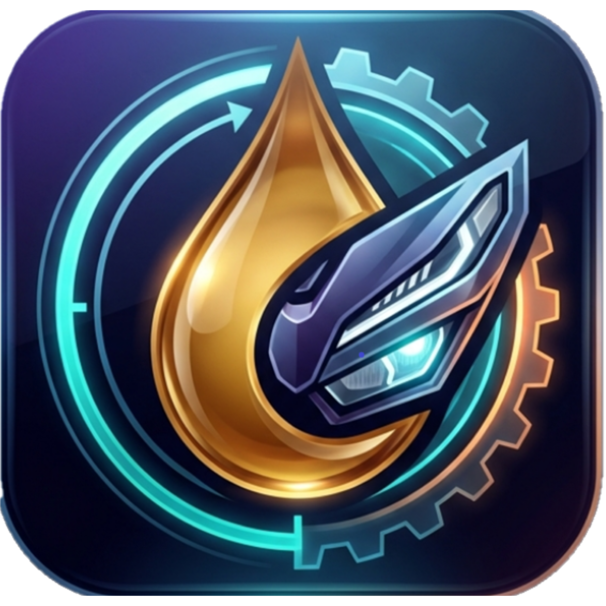

# Olikit 🛵

<p align="center">
  
</p>

<p align="center">
  <strong>Aplikasi Pintar Pengingat & Pemantau Penggantian Oli Motor</strong><br>
  Offline-first, akurat, dan dirancang dengan antarmuka modern bernuansa.
</p>

<p align="center">
  
  
  
  
  
</p>

---

## 🌟 Fitur Utama

- **⏱️ Estimasi Pintar Berdasarkan Kebiasaan Berkendara**:
  - Menghitung rata-rata kilometer harian (`km/hari`) secara dinamis dari catatan riwayat odometer.
  - Memprediksi sisa kilometer dan tanggal pasti kapan oli mesin harus diganti.
- **⚙️ Batas Interval Kustom**:
  - Pilihan cepat batas kilometer (misal 2.000 km, 3.000 km, 4.000 km) atau input angka kustom sesuai rekomendasi oli / buku manual motor Anda.
- **📅 Pencatatan Tanggal Fleksibel**:
  - Lupa mencatat ganti oli tepat waktu? Anda bisa memilih tanggal mundur dengan tombol cepat (*Hari Ini*, *Kemarin*, *3 Hari Lalu*, *1 Minggu Lalu*) atau pemilih tanggal (*Date Picker Modal*).
- **🔒 100% Offline & Privasi Terjaga**:
  - Menggunakan database lokal **Expo SQLite** langsung di penyimpanan perangkat Anda.
  - Tidak memerlukan koneksi internet, tidak ada pendaftaran akun, dan data tidak pernah dikirim ke server luar.
- **🔔 Pengingat Lokal Otomatis (09:00 Pagi)**:
  - Notifikasi saat sisa jarak $\le$ 300 km.
  - Notifikasi 7 hari sebelum batas waktu penggantian.
  - Peringatan mendesak jika kilometer/waktu sudah melewati batas (*Overdue*).
  - Pengingat rutin perbarui angka odometer setiap 14 hari.
  - Notifikasi menggunakan nama motor Anda secara dinamis.
- **💎 Antarmuka Liquid Glass Premium**:
  - Glassmorphism gelap (*Dark Theme*), ambient glow, transisi halus, serta haptic feedback responsif.

---

## 🛠️ Persyaratan Sistem

- **Node.js**: versi 18 atau lebih baru (disarankan LTS v20+)
- **NPM** atau **Bun**
- Perangkat Android fisik dengan aplikasi **Expo Go** (atau emulator Android / iOS simulator)

---

## 🚀 Panduan Memulai (Development)

### 1. Kloning Repositori & Instal Dependensi

```bash
git clone https://github.com/AbrorilHuda/olikit.git
cd olikit
npm install
```

### 2. Jalankan Server Pengembangan

Pada sistem Windows (PowerShell/CMD):
```bash
cmd /c npx expo start
```
*Atau cukup jalankan:*
```bash
npm start
```

Pindai (scan) QR code yang muncul di terminal menggunakan aplikasi **Expo Go** pada ponsel Android Anda.

---

## ☁️ Panduan Build di Expo EAS Cloud

Aplikasi ini telah dikonfigurasi dengan file [eas.json](file:///d:/open-source/olikit/eas.json) sehingga Anda dapat mem-build installer aplikasi langsung di cloud EAS (Expo Application Services) tanpa perlu menginstal Android Studio secara lokal.

### 1. Pasang & Masuk ke Akun EAS

Jika belum memiliki akun Expo, daftar gratis di [expo.dev](https://expo.dev).

```bash
# Login ke akun Expo Anda
cmd /c npx eas-cli@latest login

# Inisialisasi proyek EAS (cukup dilakukan sekali)
cmd /c npx eas-cli@latest project:init
```

---

### 2. Perintah Build

#### A. Build File APK (Siap Pasang Langsung di HP Android) — *(Disarankan)*
Profil `preview` menghasilkan file berekstensi `.apk` mandiri yang bisa langsung Anda bagikan dan instal ke smartphone tanpa lewat Google Play Store:

```bash
cmd /c npx eas-cli@latest build -p android --profile preview
```

#### B. Build File AAB untuk Google Play Store (Produksi)
Profil `production` menghasilkan file bundle `.aab` untuk diunggah ke Google Play Console:

```bash
cmd /c npx eas-cli@latest build -p android --profile production
```

#### C. Build Development Client
Profil `development` menghasilkan APK Development Build khusus yang menyertakan runtime native lengkap:

```bash
cmd /c npx eas-cli@latest build -p android --profile development
```

---

### 3. Memantau Proses & Mengunduh Hasil Build

Setelah menjalankan perintah build:
1. Terminal akan menampilkan tautan pemantau langsung di browser (contoh: `https://expo.dev/accounts/.../builds/...`).
2. Proses kompilasi akan berjalan di server cloud Expo selama ~5-15 menit.
3. Setelah selesai, terminal akan memberikan **QR Code & Link Unduhan Langsung** untuk mendownload file `.apk` ke ponsel Anda.
4. Anda juga dapat melihat daftar riwayat build kapan saja dengan:
   ```bash
   cmd /c npx eas-cli@latest build:list
   ```

---

## 🧪 Pengujian & Kualitas Kode

Sebelum mempublikasikan atau membuat perubahan kode, pastikan seluruh pengujian lolos:

```bash
# 1. Menjalankan Unit Tests logika kalkulasi oli
cmd /c npm test

# 2. Pengecekan tipe data TypeScript
cmd /c npx tsc --noEmit

# 3. Pengecekan Linter (ESLint)
cmd /c npx expo lint

# 4. Diagnostik kompatibilitas paket Expo
cmd /c npx expo-doctor
```

---

## 📂 Struktur Direktori

```text
olikit/
├── assets/
│   └── images/
│       └── logo.png              # Logo aplikasi resmi
├── src/
│   ├── app/                      # Halaman rute (Expo Router)
│   │   ├── _layout.tsx           # Root navigator & tema dasar
│   │   ├── index.tsx             # Halaman Beranda (Status oli & visual gauge)
│   │   ├── catat.tsx             # Halaman Catat Ganti Oli (Tanggal fleksibel)
│   │   └── riwayat.tsx           # Halaman Riwayat & Statistik Pengeluaran
│   ├── components/
│   │   ├── modals/               # Modal interaktif (DatePicker, Onboarding, Settings, UpdateOdo)
│   │   └── ui/                   # Komponen visual (GlassView, BackgroundGlow, Button, TabBar)
│   ├── context/
│   │   └── oil-context.tsx       # State manajemen terpusat & sinkronisasi SQLite
│   ├── lib/
│   │   └── oil.ts                # Logika matematis murni kalkulasi oli & odometer
│   ├── services/
│   │   ├── db.ts                 # Lapisan penyimpanan database Expo SQLite
│   │   └── notifications.ts      # Penjadwal notifikasi lokal offline
│   └── types/
│       └── oil.ts                # Deklarasi tipe TypeScript
├── tests/
│   └── oil.test.mjs              # Unit testing Node.js
├── app.json                      # Konfigurasi aplikasi Expo & metadata Android/iOS
├── eas.json                      # Konfigurasi build cloud EAS
└── tsconfig.json                 # Konfigurasi TypeScript
```

---

## 📄 Lisensi

Proyek ini dirilis di bawah lisensi open source [MIT License](LICENSE).
Dikembangkan untuk membantu pengendara motor merawat kendaraannya secara teratur dan presisi.
